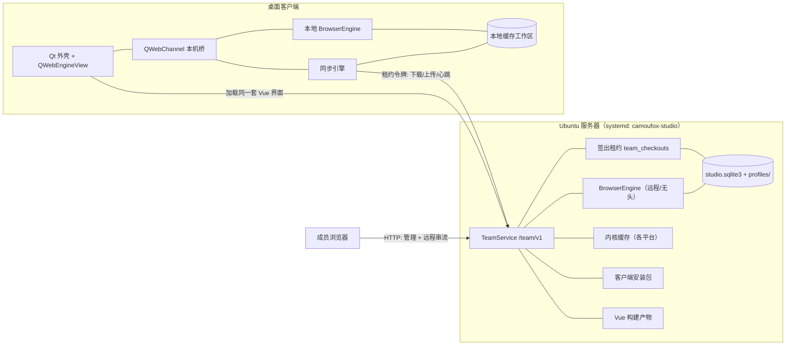

# Studio 服务器与客户端：开发设计

状态：任务 1–4 已完成并通过完整 CI；任务 5–18 代码完成，集成提交已通过完整 CI 与四平台打包，后续修复仍须通过各自提交的完整门禁。实机验收与其他待完成事项见[第 12.1 节](#121-交接待完成事项)。记录日期：2026-10-17。

本文定义服务器部署、桌面客户端、远程串流和代码清理的目标形态与实施顺序。
它取代了早期"活动环境固定在一台执行机"的范围决定，[架构决策记录](studio-team.md)已同步改写；
第 13 节列出的 [既定规则](../ci/tribal-rules.yml) 修订已落实，不保留两套互相矛盾的说法。

## 1. 目标与范围

一台局域网服务器保存全部浏览器环境。成员有三种用法：

| 用法 | 浏览器运行位置 | 入口 |
| --- | --- | --- |
| 网页管理 | 不启动浏览器 | 任意浏览器打开 `http://<服务器IP>:8766` |
| 远程串流 | 服务器（Linux 私有显示） | 网页或桌面客户端的操作窗口 |
| 本机运行 | 成员电脑 | 桌面客户端的"本机启动" |

服务器是唯一的数据来源：环境配置、固定指纹、代理、成员授权和网站数据都以服务器为准。
客户端只在环境本机运行期间临时持有它。同一环境同一时刻只在一处运行。

不在范围内：多台服务器、云端同步、公网部署、互不信任租户的隔离、从未连过服务器的离线首次启动。

## 2. 已定决策

| 决策 | 内容 | 接受的代价 |
| --- | --- | --- |
| 自由签出 | 有"本机运行"授权的成员可把任意环境签到任意客户端运行 | Canvas、WebGL 像素、字体渲染和出口网络随运行主机变化；项目不掩盖这些差异 |
| 自动签出签回 | "本机启动"自动锁定并下载，关闭浏览器后自动上传并解锁 | 签回前浏览器必须正常关闭 |
| 官方内核、多版本共存 | 只用 daijro/camoufox 官方发布版；每个环境固定自己的内核版本，可单独升级 | 服务器需缓存各平台内核 |
| 完整客户端 | 桌面内嵌同一套 Vue 界面，另加本机运行能力；Windows、macOS、Linux 三端 | 删除现有 Qt 管理窗口 |
| 仅发行团队客户端 | 维护者于 2026-10-17 确认不再提供独立单机版；桌面始终连接团队服务器 | 不支持无需部署服务器的独立工作区；本机运行仍使用签出签回 |
| 默认 HTTP | 局域网按 IP 部署，签出默认可用，界面常驻明文提示；HTTPS 可选 | 见下方风险说明 |
| API 密钥调用 | 程序用成员 API 密钥直连服务器调用环境，取代 SSH 隧道和 `--automation-member` | HTTP 下密钥明文 |
| 唯一串流 | 按维护者 2026-10-16 决定，远程模式只保留 KasmVNC，固定组件缺失时明确失败 | 删除 PNG 串流、后端选择器和 Windows 专用会话串流 |
| 唯一前端 | `frontend/studio` 是唯一网页界面 | 删除 Python 包内置控制台 |
| 服务器平台 | Ubuntu 24.04 x86_64 + systemd，不使用 Docker；远程串流只在 Linux 服务器提供 | 删除 Windows 专用会话串流后端 |

HTTP 风险：签出包含各网站的 Cookie、登录状态和代理密码，登录密码、远程画面和客户端
安装包也是明文。同一局域网内能抓包或做中间人的设备可以读取或替换这些内容。
成员鉴权、私网限制和 IP 白名单都不加密流量。需要保密时用 `--origin https://...`
配合证书启动，其余行为不变。

保持不变的原则：

- **一个启动引擎。** 服务器远程运行和客户端本机运行都调用 `studio/engine.py` 的
  `prepare_launch` 与 `BrowserEngine`，不新增第二条启动或指纹生成路径。
- **一个授权来源。** 所有权限判断都在服务器 `MemberStore`；客户端不保存成员库。
- **失败要明确。** 内核缺失、版本不符、代理检查失败、签回冲突都中止并说明原因，
  不回退直连、不换内核、不重置指纹。
- **调用接口保留。** 本机调用、跨电脑调用和创建环境接口继续可用，协议版本不变，见第 8 节。

## 3. 总体架构



| 组件 | 职责 | 代码位置 |
| --- | --- | --- |
| 团队服务 | 登录、授权、环境与代理管理、远程运行、签出租约、内核与安装包分发 | `pythonlib/camoufox/studio/team/` |
| Vue 界面 | 网页与桌面共用的全部管理和远程操作界面 | `frontend/studio/` |
| 桌面外壳 | 窗口、服务器地址、本机桥、下载与弹窗处理、自动更新 | 新增 `pythonlib/camoufox/studio/client/` |
| 同步引擎 | 签出下载、增量比较、签回上传、断线补传；不依赖 Qt，可单独测试 | `studio/client/sync.py` |
| 本地运行 | 复用 `BrowserEngine`，以本地缓存工作区为存储 | 复用 `studio/engine.py`、`studio/store.py` |

## 4. 服务器部署规范

### 4.1 主机

- Ubuntu 24.04 x86_64，物理机或虚拟机，非 root 专用账号 `camoufox`。
- 需要允许 bubblewrap 创建用户命名空间，依赖与原因见 [远程窗口说明](studio-remote-view.md)。
  Docker 默认的系统调用限制会阻止它，特权容器不可接受，因此不提供容器部署。
- 远程串流依赖 `xvfb xauth xdotool bubblewrap xclip fontconfig` 及
  `python -m playwright install-deps firefox`；KasmVNC 为唯一固定串流组件，见
  [固定运行组件](studio-kasmvnc-runtime.md)。
- 安装器为 systemd 服务账号配置独立 Secret Service，使用本机加密凭据解锁持久钥匙环，
  启动前检查原生秘密读写；失败则拒绝启动，不降级为明文。升级保留钥匙环及解锁凭据，
  保护范围与旧后端接入见[服务账号凭据](studio-team-service.md#服务账号凭据)。

### 4.2 目录布局

```text
/opt/camoufox-studio/              程序与 .venv（发布包或源码检出）
/etc/camoufox-studio/studio.env    启动参数
/var/lib/camoufox-studio/
├── workspace/                     工作区：studio.sqlite3、profiles/；备份对象
├── staging/                       签回暂存，必须与 workspace 在同一文件系统
├── kernels/                       各平台内核压缩包及摘要
└── clients/                       客户端安装包及版本清单
```

`staging/`、`kernels/` 和 `clients/` 不放进工作区：`backup.create_snapshot` 会拒绝工作区
根目录下的未知文件，而且内核与安装包不是用户数据。暂存目录与工作区同一文件系统，
签回提交才能用原子改名完成。

### 4.3 启动参数

`studio.env` 示例，IP 换成服务器的实际局域网地址：

```bash
STUDIO_ORIGIN=http://192.168.1.10:8766
STUDIO_LISTEN=0.0.0.0
STUDIO_BROWSER_MODE=remote
STUDIO_AUTOMATION_LISTEN=0.0.0.0:8767
STUDIO_EXTRA=--private-network-only
```

`STUDIO_AUTOMATION_LISTEN` 开启第 8.1 节的 API 密钥接口，不需要时删掉这一行。

- `--origin` 必须与成员地址栏中的地址完全一致，包括端口。按 IP 部署时所有客户端都用这个 IP。
- `--private-network-only` 与 `--allow-client` 继续可选，规则见
  [原生部署验收](studio-native-acceptance.md#默认-http-与可选网络范围)。
- `--web-root` 删除。Vue 构建产物随 Python 包提供，缺失时服务拒绝启动。
- 新增 `--client-root /var/lib/camoufox-studio/clients`、`--kernel-root /var/lib/camoufox-studio/kernels`、
  `--staging-root /var/lib/camoufox-studio/staging`，由安装脚本写入默认值。

### 4.4 systemd

安装脚本生成 `camoufox-studio.service`，要点：

- `User=camoufox`，`EnvironmentFile=/etc/camoufox-studio/studio.env`。
- `LoadCredentialEncrypted` 交付钥匙环口令；独立 `RuntimeDirectory` 为 `0700`，
  `UMask=0077`，关闭 core dump。凭据启动器原位执行原团队入口，保留主进程与正常停止语义。
- `Restart=no`。异常退出后留下的运行记录必须经 `studio-recover` 显式恢复，
  自动重启只会反复失败，也不能替代恢复流程。
- 停止超时足够让所有浏览器正常关闭；服务自身管理进程边界。
- 不启用会阻止用户命名空间的加固项（如 `RestrictNamespaces`、`PrivateUsers`）。
  其余加固项在实机验收通过后再写入。

### 4.5 安装与运维

新增 `scripts/install-studio-server.py`，结构参照 `scripts/install-studio-ubuntu.py`：

1. `sudo` 安装系统依赖，创建账号与目录，权限 `0700`。
2. 用 `pythonlib/team-requirements.lock` 建立虚拟环境；源码部署时构建 Vue（需要 Node.js 22）。
3. 以服务账号运行 `camoufox fetch`，缓存当前默认内核的各平台包。
4. 交互运行 `studio-team-init` 创建首个管理员，写入 env 文件和 systemd 单元，启用服务。
5. 输出访问地址与防火墙建议：只对局域网网段放行 8766（网页与客户端），开启 API 密钥接口时再放行 8767，
   例如 `ufw allow from <局域网网段> to any port 8766 proto tcp`。

升级：停止服务，更新程序目录，重新执行安装脚本的依赖步骤，启动服务；工作区不动。
备份沿用 [加密快照](studio-backup.md)；有未签回的租约时快照拒绝执行（见 5.3）。

## 5. 签出协议

### 5.1 权限

新增授权码 `checkout`（界面名称"本机运行"），角色上限为管理员和操作员，可经直接授权和成员组授权。
它独立于 `operate`，因为签出会把网站登录状态和代理密码交给成员电脑，比在服务器上
操作浏览器暴露得更多。`GRANT_PERMISSIONS`、`ROLE_PERMISSIONS`、`GROUP_PERMISSIONS`、
Vue 授权界面同步更新。

### 5.2 数据模型

团队 schema 升到 v5，新增：

```sql
CREATE TABLE team_checkouts (
    id TEXT PRIMARY KEY,
    profile_id TEXT NOT NULL REFERENCES profiles(id),
    member_id TEXT NOT NULL,
    device_id TEXT NOT NULL,
    state TEXT NOT NULL,          -- checked_out | returning | returned | revoked
    token_hash TEXT NOT NULL,
    data TEXT NOT NULL            -- 设备名、平台、基线数据版本、时间、心跳
);
CREATE UNIQUE INDEX team_checkouts_active ON team_checkouts(profile_id)
    WHERE state IN ('checked_out', 'returning');
```

每个环境另记 `data_revision`（网站数据版本），每次成功签回加一。它与现有配置
`revision` 分开：编辑配置不改变网站数据，签回不改变配置。

租约不用 `team_runs` 表示。`check_execution_ownership` 要求所有未停止的运行属于同一服务
所有者，把租约写成运行记录会阻止服务器上所有启动。

### 5.3 互斥门禁

运行和租约在同一个 SQLite 写事务（`BEGIN IMMEDIATE`）里互相检查：

| 操作 | 有活动租约时 |
| --- | --- |
| 远程/无头启动 `TeamRepository.reserve` | 拒绝，`profile_checked_out` |
| 远程入口 `remote_entry` | 返回原因 `checked_out` 及持有设备 |
| 编辑、删除、重建指纹、升级内核 `ensure_editable` | 拒绝，`profile_checked_out` |
| 复制环境 | 允许，只复制配置 |
| 备份快照、迁移准备 | 拒绝，`checkout_active` |

反过来，环境有活动运行、活动租约或进行中的维护任务时，签出被拒绝。

### 5.4 自动签出与本机启动

1. 成员在客户端点"本机启动"。Vue 调用 `POST /team/v1/profiles/{id}/checkout`
   `{request_id, device_id, device_name, platform}`，使用正常登录 Cookie 和 CSRF。
2. 服务器在一个事务内校验 `checkout` 授权、无活动运行、无活动租约、无维护任务，
   创建租约，返回租约 ID 和一次性租约令牌（256 位随机值，数据库只存摘要）。
3. Vue 把租约 ID 和令牌交给本机桥；之后的传输由同步引擎用 `Authorization: Bearer`
   访问 `/team/v1/checkouts/{checkout_id}/...`，与 12 小时登录会话解耦。
4. 同步引擎取得签出清单：环境配置、固定指纹、绑定代理（含密码）、所需内核、
   网站数据文件清单（相对路径、大小、SHA-256）及 `data_revision`。
5. 与本地缓存比较，只下载有变化的文件，校验摘要后写入本地缓存工作区。
6. 按 6.3 准备内核，然后由本地 `BrowserEngine` 启动。
7. 运行期间每 15 秒心跳一次，用于界面显示最后在线时间和接收撤销通知。

租约不会因心跳中断而自动过期。服务器无法判断失联客户端的浏览器是否已停止，
自动过期会让两处同时运行同一身份。只有签回或管理员强制解锁能结束租约。

### 5.5 自动签回

1. 浏览器关闭后，等待引擎正常结束。会话清理失败（`recovery_required`）时不上传，
   界面提示需要恢复，租约保持。
2. 同步引擎计算本地文件清单，与签出时的基线比较，得到新增、修改和删除的文件。
3. `POST /checkouts/{id}/return` 把租约置为 `returning`，再以一个 `ZIP_STORED` 流上传变化的文件。
   服务器逐项流式写入 `staging/<checkout_id>/`，校验大小与摘要。
4. `POST /checkouts/{id}/commit` 提交完整清单。服务器在暂存区组装新目录，未变化文件取自
   当前目录，再次核对全部摘要，然后：先写入持久的提交记录，再以原子改名替换
   `profiles/<id>`，`data_revision` 加一，租约置为 `returned`，最后删除旧目录。
   服务启动时检查未完成的提交记录，完成或回滚这次改名，不留下半个目录。
5. 本地缓存保留这份数据，供下次增量下载；代理密码从本机凭据库删除。

断网或客户端崩溃时，待签回记录保存在本地缓存里。下次启动客户端并连上服务器后自动续传。
仍持有租约、尚未签回的环境可以离线再次在本机打开，因为服务器在租约结束前不会运行它。

文件遍历与校验复用 `backup.py` 的 `checked_name`、`_regular` 和 `_profiles` 规则：拒绝链接、
硬链接、不可移植的文件名和大小写冲突，跳过 Firefox 锁文件。以下可再生缓存不同步：
`cache2/`、`startupCache/`、`thumbnails/`、`crashes/`、`minidumps/`。效果相当于每换一处运行就清空一次缓存。

### 5.6 撤销与强制解锁

- **撤销授权：** 成员的 `checkout` 授权被收回或账号停用后，下次心跳返回撤销。
  客户端关闭浏览器，正常签回数据，然后结束租约。网站数据属于环境，不随成员丢弃。
- **强制解锁：** 客户端丢失或长期失联时，管理员在界面确认后把租约置为 `revoked`。
  服务器回到最后一次签回的数据；那台客户端之后的上传以 `checkout_revoked` 拒绝。
- **失效副本：** 客户端收到 `checkout_revoked` 后不删除本地数据，移到"失效副本"并停用，
  界面提示联系管理员。它不能再签回，也不能启动。

备份与迁移在有活动租约时拒绝，因为快照会捕获过时数据。需要备份时先等签回或强制解锁。

### 5.7 指纹生成

身份唯一性记录在服务器的 `identity_history`。从未启动过的环境首次签出时，指纹仍由
`engine._new_identity` 在运行主机上生成，客户端本地存储的 `claim_identity` 改为调用
`POST /checkouts/{id}/identity`，由服务器的 `ProfileStore.claim_identity` 原子判重并保存。
生成代码只有一份，判重账本只有一个。

使用真实字体、WebGL、语音或媒体设备（`native` 模式）的环境，`validate_environment`
仍要求目标系统与运行主机一致。在其他系统上启动会明确失败，不自动切换模式。

### 5.8 接口清单

| 接口 | 鉴权 | 作用 |
| --- | --- | --- |
| `POST /profiles/{id}/checkout` | Cookie + CSRF + `checkout` | 创建租约，返回令牌 |
| `GET /checkouts/{id}` | 租约令牌 | 签出清单 |
| `POST /checkouts/{id}/files` | 租约令牌 | 按清单请求文件，返回 `ZIP_STORED` 流 |
| `POST /checkouts/{id}/identity` | 租约令牌 | 首次指纹判重保存 |
| `POST /checkouts/{id}/heartbeat` | 租约令牌 | 在线状态与撤销通知 |
| `POST /checkouts/{id}/cancel` | 租约令牌 | 本机从未启动时放弃租约，服务器数据不变 |
| `POST /checkouts/{id}/return` | 租约令牌 | 上传变化文件到暂存区 |
| `POST /checkouts/{id}/commit` | 租约令牌 | 提交签回并结束租约 |
| `POST /profiles/{id}/release` | Cookie + CSRF + 管理员 | 强制解锁 |

查询参数继续禁止，Host 与 Origin 检查继续生效；同步引擎发送与服务器一致的 Origin。
传输接口有单独的大小上限与读取超时：单文件上限 4 GiB，单环境总量沿用备份的 32 GiB 上限，
超时按数据块空闲时间计算，不按整个请求。限流按租约计数，避免大量小文件触发全局限流。
`GET /profiles` 的每个环境增加 `checked_out` 字段：持有成员、设备名、平台、开始时间、最后心跳。

## 6. 内核多版本

### 6.1 环境与内核的绑定

- 环境配置新增 `kernel` 字段（内核 ID，如 `official/152.0.4-beta.31`），新建时取服务器默认内核。
  修改它与修改系统、语言一样会清除指纹，下次启动重新生成，网站数据保留。界面上的"升级内核"就是这个操作。
- 新生成的身份除 `browser_version` 外记录完整内核 ID。
- 历史身份只有 `browser_version`。按它匹配已缓存内核；匹配不到或匹配到多个时启动失败，
  提示管理员为该环境指定内核，不猜测。

### 6.2 启动时选择内核

`prepare_launch` 不再读取全局"当前内核"，改为：

1. 有身份时用身份记录的内核，否则用环境的 `kernel` 字段。
2. 在本机已安装内核（`multiversion.list_installed`）中按仓库、版本、构建精确查找。
3. 找不到时明确失败。服务器端提示先缓存该内核；客户端由同步引擎先下载。
4. 可执行文件的 `application.ini` 版本仍须与身份 `browser_version` 一致。

设置中的 `executable_path` 只用于开发调试，不参与团队环境的内核选择。

### 6.3 服务器缓存与分发

- 管理员在 Vue 内核页选择版本，服务器为 `lin-x86_64`、`win-x86_64`、`mac-arm64`、`mac-x86_64`
  分别下载官方压缩包。`pkgman.list_available_versions` 已支持 `spoof_os`、`spoof_arch`，
  SHA-256 取自 GitHub 资产摘要；没有摘要的资产拒绝缓存。
- 服务器本机运行用的 Linux 内核由缓存包安装到 `multiversion` 的标准目录。
- `GET /team/v1/kernels/{kernel_id}/{platform}` 用租约令牌或登录 Cookie 下载，响应附摘要。
  客户端校验后安装到本机 `multiversion` 目录，不需要访问 GitHub。
- 仍被任何环境引用的内核不能删除。

### 6.4 扩展与指纹模型

默认扩展和已校验的 fpgen 模型随服务器和客户端安装包提供。身份中的扩展路径是生成主机的路径，
`distribution.profile_addon_paths` 改为按扩展名映射到本机默认扩展；本机缺少某个扩展时启动失败。

## 7. 桌面客户端

### 7.1 结构

- **外壳：** PySide6 `QMainWindow` + `QWebEngineView`，使用持久化 `QWebEngineProfile`，
  登录 Cookie 跨重启保留到过期。首次运行用一个原生对话框填写服务器地址并测试连接，可保存多个地址。
- **本机桥：** `QWebChannel` 对象，只注入到所配置服务器源的页面。方法：
  `capabilities()`、`attach(workspaceId)`、`launchLocal(profileId, lease)`、`stopLocal(profileId)`、
  `cancelLocal(profileId)`、`localStates()`、`pendingReturns()`、`openDataFolder(profileId)`、
  `networkInterfaces()`、`localSettings()`、`saveLocalSettings(settings)`、`automationStatus()`，返回 `{ok}` 或 `{error}`，
  状态变化经 `localChanged(profileId, state)` 推送。只接受环境 ID、租约数据和固定的本机设置字段
  （`max_running`、`automation_enabled`），不接受文件路径。通道不能识别调用页面，每次调用都重新核对
  主窗口当前页面的协议、主机和端口与所配置服务器一致。
- **弹窗与下载：** 重写 `createWindow`，远程操作窗口（`window.open`）在新顶层窗口打开；
  `downloadRequested` 弹出保存对话框；开启剪贴板写入，供远程复制使用。
- **本地运行：** 外壳的 `BrowserThread` 持有唯一事件循环，`BrowserEngine` 的
  `authorize_start` 改为"本设备持有有效租约"。
- **退出：** 有本机运行的环境时提示先关闭；退出前完成签回，失败的保留为待签回。

已按 Qt 6.11 文档与本机探测核实：`qwebchannel.js` 以 `QWebEngineScript` 在 `MainWorld` 的文档创建时注入，
服务器 `script-src 'self'` 的 CSP 下仍可调用本机桥；`createWindow` 需开启 `JavascriptCanOpenWindows`；
剪贴板写入需 `JavascriptCanAccessClipboard`，`ClipboardReadWrite` 权限只授予所配置服务器源；
下载只接受来自该源页面的请求。其他源的导航不在客户端内加载，链接交给系统浏览器打开。

### 7.2 Vue 侧

- 新增 `src/desktop/bridge.ts`，检测本机桥；网页中不显示桌面专属按钮。
- 环境列表：本机运行状态与服务器状态合并显示；被其他设备签出的环境显示持有者和设备。
- 环境操作：本机启动、停止本机；管理员可强制解锁、升级内核。
- 授权界面增加"本机运行"；HTTP 连接时页面顶部常驻明文提示。
- 下载页列出服务器托管的三端客户端安装包。
- 桌面“本机设置”包括并发上限、本机自动化开关与连接文件路径（第 8 节）。
  这些设置保存在本机缓存工作区。

### 7.3 本地缓存

- 位置：系统用户数据目录（`platformdirs.user_data_dir`）下的 `TigerBrowser/servers/<workspace_id>/`，
  每个服务器一个缓存工作区，由 `WorkspaceLock` 保护，同一时间只允许一个客户端进程。
- 内容：只含签出过的环境；网站数据目录结构与服务器一致，复用 `ProfileStore`。
- 代理密码签出时写入本机原生凭据库，签回后删除；不写入文件。
- 退出登录时可选择清除本服务器的缓存；有待签回或失效副本时不清除，先提示处理。

### 7.4 打包

| 平台 | 产物 | 安装位置 | 备注 |
| --- | --- | --- | --- |
| Windows 10/11 x64 | Inno Setup 安装程序 | 当前用户 `%LOCALAPPDATA%\Programs`，无需管理员 | 未签名，首次运行有 SmartScreen 提示 |
| macOS arm64、x86_64 | `.app` 装入 `.dmg` | `/Applications` 或用户应用目录 | 未签名公证时需右键打开 |
| Ubuntu 24.04 x64 | `.deb` | `/opt/tigerbrowser-client` | 依赖由包声明 |

- 三端分别在各自系统上用 PyInstaller 构建，`scripts/studio.spec` 改为按平台分支；
  Windows 使用 GUI 主程序和用于打包时运行检查的控制台辅助程序。
- 包含 Python、Qt（含 QtWebEngine，现有锁文件中的 `pyside6-addons` 已提供）、Playwright 驱动、
  默认扩展、指纹模型；不内置浏览器内核，按环境从服务器取得。
- Inno Setup 是新增的构建期工具，引入时在 PR 中说明理由并固定版本。
- 支持的最低系统版本以 PySide6 6.11 官方支持范围为准。
- CI 新增三端打包矩阵，产物发布到 GitHub Releases，管理员下载后放入服务器 `clients/`。

### 7.5 自动更新

- `clients/manifest.json` 记录版本、平台、文件名、SHA-256、最低兼容协议版本。
- 登录后客户端读取 `GET /team/v1/client/update`。服务器协议版本高于客户端支持范围时，
  客户端只显示更新页面，不允许操作；有新版但兼容时提示更新。
- 下载后校验摘要。Windows 静默运行安装程序后退出；macOS 替换应用包（无写权限时打开 dmg）；
  Linux 调用系统软件安装器打开 `.deb`。
- 走 HTTP 时摘要与安装包来自同一明文连接，无法防止中间人替换。这是默认 HTTP 的已接受风险，
  启用 HTTPS 后才有传输保护。

### 7.6 仅提供连接服务器的客户端

维护者于 2026-10-17 确认：只维护“团队服务器＋图形客户端”，不再开发或单独打包
独立单机版，也不新增独立单机项目目录、工作区类型或更新渠道。图形客户端已提供
本机运行入口，不因此增加一套脱离服务器的产品。

桌面必须连接服务器，环境、成员和授权由服务器管理；本机运行仍通过签出与签回完成。
“在本机运行浏览器”不等于“不需要服务器”。服务器以 Ubuntu 24.04 为部署目标，
不能把 Windows/macOS 客户端安装包当成独立服务器或无需服务器的软件。

服务器工作区和客户端签出缓存保持分离。客户端缓存仅供该服务器的签出流程使用，
不得把两者设置为同一个可写目录，也不得用共享文件夹或网盘同步绕过签出流程。
签出期间服务器拒绝该环境的启动和编辑；浏览器关闭、数据提交成功后才完成签回。
断网或签回失败保留待签回状态，不根据等待时间推断另一处已经停止运行。

无成员的 `--local` 模式与 `studio-host` 单令牌接口随旧 Qt 管理窗口一起删除，
客户端不内嵌第二个团队服务器。已存在的无成员工作区按明确的接入流程迁入团队服务，
保留身份和网站数据；不恢复旧单机入口作为失败时的替代路径。

## 8. 调用接口

`/automation/v1` 仍为协议版本 1：端点、请求体、借用、任务标签页和心跳都不变，
现有调用代码不用改请求逻辑。变化在于怎样连到服务器。
本节的"借用"指自动化接口的 `/automation/v1/leases`，与第 5 节的签出租约是两回事。

协议 1 的后续扩展通过能力字段协商：页面被动响应观察、下载 URL 筛选和有界二进制
分块读取复用同一个自动化桥，不改变启动、主世界授权和借用归属。旧 Base64 下载仍兼容。
接口、错误码、Node 示例及缓冲限制见[响应与传输协议](studio-response-transfer.md)。

| 调用方式 | 现状 | 新设计 |
| --- | --- | --- |
| 调用服务器上的环境（本机或跨电脑） | 服务器本机用 `--automation-member`；跨电脑用 SSH 端口转发 | 改为 API 密钥直连服务器，见 8.1；删除 `--automation-member` 与 SSH 隧道方案 |
| 调用客户端本机运行的环境 | 桌面"工作区设置 → 本地自动化接口"开关，按当前登录成员授权 | 保留；开关移到 Vue 设置页，只在桌面显示，见 8.2 |
| 创建环境 `POST /profiles` | 各入口都支持，需要管理员 | 保留；API 密钥和客户端都在服务器上创建 |
| 团队管理接口 `/team/v1` | 网页登录、环境与代理管理、远程操作 | 保留，增加第 5.8 节的签出接口 |
| Python 库 `Camoufox` / `AsyncCamoufox` | 程序自行启动浏览器 | 保留 |
| TypeScript 库 `typescript/` | Node.js 程序自行启动浏览器，不访问 Studio 环境 | 删除（已确认没有使用方） |
| 无成员本机接口 `studio-host` | 无成员工作区的单令牌接口 | 删除，客户端必须连接服务器 |

### 8.1 API 密钥直连服务器

SSH 隧道在局域网里并不明显更慢：每次调用是一个小的 JSON 请求，耗时主要在浏览器操作本身，
加密和多一跳带来的延迟通常可以忽略。换成密钥的原因是好用：不需要 SSH 账号和端口转发，
地址和密钥固定，服务重启后不用重新复制连接文件，每个调用方一把密钥、可以单独吊销。
代价是 HTTP 下密钥明文传输，而 SSH 隧道是加密的。

- **监听：** 服务器另开一个端口（默认 8767）提供 `/automation/v1`，复用现有 `AutomationBridge`
  的请求处理和限制（请求体 321 MiB、单次操作 330 秒、连接上限）。不并入 8766 的网页服务，
  避免长时间的浏览器操作占满网页服务的单进程连接数。启动参数 `--automation-listen` 默认关闭，
  显式开启。
- **密钥：** 在 Vue"API 密钥"页面创建，属于创建它的成员（管理员或操作员，只读成员不能创建）。
  密钥为 256 位随机值，只在创建时显示一次，数据库只存摘要。可选设置有效期、限定环境范围、
  限定来源 IP/CIDR。管理员可以查看和吊销所有密钥，成员可以管理自己的密钥。
- **连接文件：** 创建后可下载 `automation.json`，内容为
  `{"protocolVersion":1,"baseURL":"http://<服务器IP>:8767","token":"<密钥>"}`。
  现有调用方把 `CAMOUFOX_STUDIO_CONNECTION_FILE` 指向这个文件即可，代码不变。
- **授权：** 每个请求都按密钥所属成员的当前角色和授权重新判断，复用 `MemberStore`，
  再与密钥的环境范围取交集。授权变化立即生效，不需要重启服务。成员停用后其密钥全部失效。
- **借用归属：** 每把密钥只能操作自己创建的借用和任务标签页；吊销密钥时关闭这些标签页、释放借用，
  不停止浏览器。现在的实现只有一个令牌，借用不区分归属，这里需要补上。
- **运行位置：** 浏览器在服务器上运行，沿用团队服务的持久运行记录、并发上限和原生会话检查。
  `headless:false` 在远程模式下启动有窗口的私有显示，成员可在网页远程窗口里同时观看。
  环境被签出到客户端时返回 HTTP 409，错误码 `profile_checked_out`。
- **边界：** 继续拒绝带 `Origin` 头的请求，网页脚本无法使用密钥；`Host` 必须与服务器地址一致；
  不支持查询参数传密钥。审计记录密钥创建、吊销与最后使用时间，不记录每次调用的内容。
- **HTTP 风险：** 同一局域网内抓包可以拿到密钥，进而控制该成员授权范围内的已登录浏览器。
  建议给每把密钥设置来源 IP 限制；需要保密时启用 HTTPS。

### 8.2 客户端本机调用

调用在成员电脑上本机运行的环境时，沿用现有的本机发现文件和令牌，只监听 `127.0.0.1`。

- **列出环境：** 当前登录成员在服务器上可见的环境，状态合并本机与服务器两处。
- **启动：** 需要 `checkout` 授权。启动即自动签出并在本机运行，之后的借用、任务标签页、
  心跳与释放和现在完全一致。环境正在服务器运行或被其他设备签出时返回 HTTP 409。
- **结束：** 与现在一样，接口不关闭浏览器。成员在客户端停止或关闭浏览器后自动签回。
- **连接文件：** `automation.json` 改在本机缓存工作区（第 7.3 节）内，设置页显示实际路径。
  原先指向旧桌面工作区的调用方需要改一次连接文件路径。
- **撤销：** 退出登录、改密码或权限变化时停止授权，与现在桌面接口的规则相同。
- **创建环境：** 转发到服务器创建，需要管理员；新环境存于服务器。

## 9. 设置项改为选择

### 9.1 代理地址

保存 HTTP、HTTPS 或 SOCKS5 代理，启动时验证选定的路由。详见[代理配置](studio-nodes.md)。

### 9.2 时区

现状：Vue 编辑页已按服务器规范时区索引分组搜索；保存时仍用 `ZoneInfo` 校验 IANA 名称。
旧 Qt 管理窗口保持原编辑方式，在任务 11 由统一 Vue 界面接替。

新设计：

- 编辑页改为可搜索的下拉。第一项为"自动（跟随代理出口）"，即保存为空，启动时按出口时区设置，
  与现在的默认行为一致。
- 选项由服务器 `GET /team/v1/timezones` 提供，来源是服务器的 tzdata，与保存时的校验同源，
  不在前端另存一份时区表。按地区分组显示，例如"亚洲 · Asia/Shanghai"。
  只列规范时区，不列 `US/Pacific` 这类旧别名；分组与规范名的数据来源在实施时按所用 tzdata 版本核实。
- 已绑定代理且探测过出口的环境，下拉上方提示最近一次探测到的出口时区，便于对照。
- 已保存的旧值即使不在列表中也照常显示和保留，校验规则不变。

## 10. 前端统一

1. 先逐项核对内置控制台（`studio/team/web/team.js`、`remote.js`）有而 Vue 缺少的功能，全部补齐后再删除。
2. `team/web/remote-input.js` 与 `.d.ts` 迁移为 `frontend/studio/src/components/remote/remote-input.ts`，
   删除 `vite.config.ts` 中对 Python 包目录的 `fs.allow`。
3. KasmVNC 解码器构建（`scripts/studio-kasm-client/`）输出改到 `frontend/studio/public/kasm-client/`，
   随 Vue 构建发布；`assets.py` 的固定公共文件清单相应扩展，许可证与来源文件一并保留。
4. Vue 构建输出到 `pythonlib/camoufox/studio/team/web/`（不进 Git），随 wheel 和 PyInstaller 打包。
   服务固定从这里读取 Vite 清单，`--web-root` 与旧控制台路由删除。
5. 迁移 `typescript/tests/studio-team-console.test.ts` 中仍适用的用例（加密随机请求 ID、
   输入合并等）到 `frontend/studio/src/__tests__/`。

## 11. 代码清理

任务 1–4 已使用独立 PR。任务 5–18 按依赖顺序在同一个升级分支集中开发，完成后
统一提交 PR、执行完整 CI 与打包验收；不为每个小项重复全量流水线和安装包构建。
开发期间保留受影响功能的定向回归，权限、数据归属与迁移等问题须在实现时复现和修复。
先实现服务器 API 密钥与内核管理，再实现签出同步与 Vue 桌面，最后清理旧代码、
完善安装更新和文档。物理设备验收与模拟、同机或 CI 检查分别记录。

### 11.1 先迁移再删除

| 被依赖项 | 依赖方 | 处理 |
| --- | --- | --- |
| `additions/browser/branding/camoufox/firefox.ico`、`default128.png` | `scripts/studio.spec`、`install-studio-ubuntu.py` | 移到 `assets/studio/` |
| `upstream.sh` 作为源码根目录标记 | `distribution.default_workspace` | 改用 `pythonlib/camoufox/studio` 与仓库标记文件判断 |
| `native-tests/test_tribal_rules.py` | 既定规则的自动检查 | 保留规则的检查移到 `pythonlib/tests/` |
| `ci.run_pythonlib` 依赖的 `ci/results.py`、`ci/_util.py`、`ci/_pytest.py` | Python 门禁 | 保留 |
| `scripts/pin-fpgen-model.py`、`scripts/data/fpgen-model.json` | CI 安装固定模型 | 保留 |
| `typescript/tests/studio-team-console.test.ts` | 规则证据 | 按第 10 节迁移 |
| `build-tester/src/lib/checks/collectors.ts` | 原生诊断、采集器来源摘要检查 | 迁至 `frontend/studio/src/diagnostics/`，由 Vue 项目的固定 esbuild 生成 `team/probe.js` |
| `service-tester` 旧指纹检测脚本 | 依赖已删除的 build-tester | 随批次 A 删除旧脚本，保留独立的 `studio_*` 实机检查与前置要求 |

### 11.2 删除清单

| 批次 | 删除 | 原因 |
| --- | --- | --- |
| A 浏览器构建 | `patches/`、`additions/`、`settings/`、`bundle/`、`assets/` 中的 mozconfig 与构建资源、`Makefile`、`Dockerfile`、`.dockerignore`、`multibuild.py`、`upstream.sh`、`build-tester/`、`tests/`、`native-tests/`、`typescript/`、`example/`、`ci/` 中浏览器相关模块、`.github/workflows/release.yml`、`.github/actions/prepare-browser/`、`scripts/` 中构建与字体工具、对应的上游文档（`FONTS.md`、`input-dispatch.md`、`MEDIA-DEVICES.md`、`patch-upgrading-guide.md`、`per-context-patches.md`、`playwright-maintenance.md`） | 只用官方发布版内核 |
| B 内置控制台 | `studio/team/web/` 下的 `index.html`、`team.js`、`team.css`、`remote.js`、`remote-input.*`、`kasm-client*`（已迁移）及其测试 | Vue 成为唯一前端 |
| C Qt 管理窗口 | `window.py`、`dialogs.py`、`team_dialogs.py`、`gui/` 内核管理器与 `--kernel-manager`、对应测试 | 界面由 Vue 提供 |
| D Windows 串流 | `team/windows.py`、`windows_files.py`、`windows_worker.py`、`--windows-user` 及相关测试与文档 | 远程串流只在 Linux 服务器 |
| E 计划类文档 | `studio-team-delivery.md`、`studio-team-modules.md`、`studio-web-console.md`、`studio-frontend-handoff.md`、`studio-kasmvnc-development-plan.md`；`studio-team.md` 精简为架构决策记录 | 内容由本文和实现后的使用文档取代 |

`ci/tribal-rules.yml` 中只针对浏览器补丁的规则（Canvas、字形间距、语音、动画、页面隔离、
输入调度等）随批次 A 删除；与 `pythonlib` 和 Studio 相关的规则保留并更新证据路径。
CI 收敛为：静态检查、Python 门禁、Vue 测试与构建、三端客户端打包。
`AGENTS.md`、`CLAUDE.md`、`CONTRIBUTING.md`、`ROADMAP.md`、`README.md` 在各批次中同步改写为新的仓库结构。

## 12. 实施任务与验收

每项任务可独立演示；带"实机"的验收不能用模拟测试代替。

| # | 任务 | 验收 |
| --- | --- | --- |
| 2 | 已完成：批次 A 清理与 CI 收敛（Issue #11、PR #12） | GitHub 完整门禁通过：1470 项 Python 测试通过（2 项既有字体分布数据跳过），71 项 Vue 测试及构建通过；Windows 整包、运行验证与 ZIP 制品上传通过 |
| 3 | 已完成：前端统一（第 10 节）与批次 B、唯一 KasmVNC 串流（Issue #13、PR #14） | 完整 CI 通过：1459 项 Python、50 项 Vue、8 项真实串流检查通过；Windows 打包与运行校验通过；连续启停无残留显示进程 |
| 4 | 已完成：时区列表（第 9 节） | 完整 CI 通过：1469 项 Python、58 项 Vue、9 项真实运行检查；Windows 打包通过 |
| 5 | 代码完成，待跨机验收：API 密钥接口（Issue #17，第 8.1 节） | 已实现独立 HTTP/HTTPS 监听、一次性连接文件、实时成员授权与密钥借用隔离；Windows 同机真实浏览器与文档 Node.js 示例、密钥撤销通过。响应观察与二进制分块扩展已通过 Windows 有头 Camoufox 本地 HTTP 测试及 Node 示例；Linux 原生下载、生产站点和跨电脑仍待验，见[接口边界](studio-response-transfer.md) |
| 6 | 代码完成，待跨平台验收：环境 `kernel` 字段与按身份选内核（Issue #17） | 定向检查通过；Windows 真实并行运行 `152.0.4-beta.30` 与 `beta.31`，实际进程路径、默认切换隔离、身份和网站状态保留均通过；这是同一 Firefox 基础版本的两个构建，不代表不同基础版本或三端通过 |
| 7 | 代码完成，待客户端实机验收：服务器内核缓存与分发（`--kernel-root`） | 四平台下载、摘要与大小校验、无摘要拒绝、篡改不留记录、被引用内核拒删、登录下载已通过定向测试；既有服务器已实际缓存 Linux 官方内核，其余平台客户端安装仍待验 |
| 8 | 代码完成，待统一验收：租约数据模型（团队 schema v6）、`checkout` 授权与互斥门禁 | 并发签出与启动只有一个成功；启动、编辑、删除、快照被拒，复制允许，均有定向测试 |
| 9 | 代码完成，待统一验收：签出签回接口与原子提交（`--staging-root`） | 提交前、记录后、改名中途三处崩溃重启后数据为完整旧版或新版；缺件列出、不安全路径拒绝已通过定向测试 |
| 10 | 代码完成，待统一验收：同步引擎 `studio/client/sync.py`（无 Qt） | 经真实 HTTP 服务的定向测试：只下载与上传变化文件、从服务器缓存安装内核、提交前后断线均可续传且丢失的提交响应被识别、强制解锁后本地数据移入失效副本、签回后租约令牌与代理密码离开本机凭据库 |
| 11 | 代码完成，待统一验收：桌面外壳与本机桥（`studio/client/shell.py`、`bridge.py`、`local.py`） | 定向测试：同源判断、服务器探测、本机桥拒绝其他源与非法参数、签出启动到关闭后签回、强制解锁停止浏览器并移入失效副本、每个服务器一个缓存且一次只允许一个进程；三端实机加载、弹窗、下载与剪贴板留到最终验收 |
| 12 | 代码完成，待统一验收：Vue 桌面集成与租约显示（`src/desktop/bridge.ts`、`stores/desktop.ts`、本机页） | 定向测试：以本机设备身份签出并交给本机桥、已持有租约直接继续、租约未交付时放弃、未连接缓存时拒绝、推送状态合并与刷新；HTTP 提示常驻；下载页随任务 16，三端实机操作留到最终验收 |
| 13 | 代码完成，待跨机验收：客户端本机调用接口（`studio/client/automation.py`） | 定向权限检查通过；Windows 同机以真实成员登录，经本机 HTTP 接口签出并启动真实浏览器，运行现有 Node.js 示例，关闭后签回及撤下连接文件通过；桌面三端和跨机仍待验 |
| 14 | 同机实机通过，待跨机验收：撤销、强制解锁与指纹判重 | Windows 真实浏览器验证授权收回、强制解锁旧令牌拒绝、浏览器退出后保留失效副本，以及真实 TCP 断线后续传签回；身份与 Cookie/localStorage/IndexedDB 保留，第二处启动与签出被拒；不代表物理断网与跨机通过 |
| 15 | 代码完成，待客户端实机验收：批次 C、D，取消独立本机模式 | 已删除旧 Qt 管理窗口、内核管理器与 `camoufox gui`、`--local`、`studio-host`、Windows 文件网关及其测试；`camoufox studio` 打开客户端外壳，回环自动化接口无成员登录时拒绝启动，早期无成员工作区经 `studio-team-init --existing` 保留数据接入服务器；定向测试、四平台打包及冻结运行检查通过，客户端安装后的完整操作仍待验 |
| 16 | 打包通过，待安装与更新实机验收：三端打包与自动更新（`--client-root`） | 定向测试：清单校验拒绝篡改、重复、类路径与不兼容的安装包，登录才能读取与下载，客户端校验摘要后才交给安装程序，有本机运行或源码运行时拒绝更新，不兼容时 Vue 只显示下载页；完整 CI 的四平台打包、冻结运行与制品上传通过；三端实机安装与从服务器更新一次仍待验 |
| 17 | 代码完成，待统一验收：服务器安装脚本与 systemd（`scripts/install-studio-server.py`） | 定向测试覆盖平台检查、服务账号安装、凭据密文交付、升级保留数据与设置、失败关闭；WSL Ubuntu 24.04 真实 systemd 和 GNOME Keyring 已验证读写、服务重启持久性、错误口令拒绝及恢复。全新 Ubuntu 安装、整机重启与 `studio-recover` 仍待实机验收 |
| 18 | 代码完成，待统一验收：批次 E、规则与文档 | 已删除五份计划类文档，`studio-team.md` 精简为架构决策记录，引用改指使用文档与本文；第 13 节规则修订已落实，链接检查与规则测试通过 |

端到端实机验收：一台 Ubuntu 服务器和至少两台不同系统的客户端。同一环境依次经历远程串流、
Windows 本机运行、macOS 本机运行，再回到远程串流，登录状态全程保留；任一时刻第二处启动都被拒绝。

### 12.1 交接：待完成事项

记录日期 2026-10-17，下表逐项记录完成范围，接手者按顺序处理未完成项；
完成一项即更新本表和上方任务表的对应行。定向测试或构建成功不能记为实机通过。

本地统一检查（Windows 11 x64，任务 18 提交后）：

- 规则与 `ci/tests` 36 项、Vue 71 项测试与构建、wheel 校验（46 个前端资源）通过。
- `python -m ci.run_pythonlib`：1447 项通过、8 项跳过、1 项失败、14 项错误。14 项错误是
  `test_studio_team_files.py` 在 Windows 上按设计失败（文件网关需要 Linux），在 WSL Ubuntu 中
  14 项全部通过；失败项见下表第 2 项。
- Windows 安装包构建及冻结运行检查通过（Inno Setup 6.7.3）；macOS 与 Ubuntu 安装包未在本地构建。

2026-10-17 接手补充：服务凭据后端已实现；Windows 上安装、启动、预检查、存储、规则及工作流
定向回归 179 项通过。WSL Ubuntu 24.04 的安装与启动回归及真实凭据会话测试共 29 项通过，
其中 `service-tester/studio_credentials_tests.py` 使用真实 systemd、无登录账号和 GNOME Keyring，
不是模拟后端。完整安装与跨机验收未完成；按维护者要求 macOS 最后处理。

同日并行加固（推送前的本地记录）：

- 服务器升级检查改为读取保留的 `studio.env`，复用 systemd 参数展开和团队入口解析器；
  缺失远程组件明确拒绝。安装摘要不再把“请求启动”当作“服务已就绪”。安装、凭据启动、
  预检查、存储、规则及 CI 定向回归合计 212 项通过；WSL 的安装与启动回归及两项真实
  systemd 测试共 33 项通过，此后另补两项缺失组件拒绝测试并在 Windows 通过。
- 签出重复交付、共享代理凭据释放和退出期间签回的竞态已补回归；浏览器清理不确定时，
  心跳重试也保留恢复屏障，不移动可能仍被浏览器占用的数据。客户端同步、本机执行、
  自动化、桌面桥、签出租约及规则定向回归 68 项通过（规则项与上组重叠，不相加）。
- Vue 71 项测试及构建、API 密钥和内核定向回归 24 项通过。Windows 上真实浏览器运行
  4 项通过：权限撤销与状态持久化、同机模拟服务器迁移、控制台重连、网卡与时区表单。
  测试使用临时工作区与回环 HTTP；不代表跨机 API、多版本内核或安装包实机通过。
- CI 支持先 Windows/Ubuntu、后 macOS 的手动阶段。部分阶段不冒充完整门禁，默认不上传
  安装包；PR/full 仍要求四平台上传，所有制品保留 1 天。操作与预算边界见
  [分阶段云端验证](../ci/README.md#staged-cloud-validation)。本次没有推送或触发云 CI。

同日最终集成补充（云端验证前的本地记录）：

- 既有 GNOME Keyring 口令文件的换行也是口令字节；启动器不再拒绝这类凭据，
  接入时不裁剪或追加字节。新增回归先复现拒绝，再验证原样传递；凭据启动、安装器及
  既定规则定向回归 54 项通过。原钥匙环和原凭据不重建，接入说明见服务部署文档。
- WSL Ubuntu 24.04 最终完整 `ci.run_pythonlib`：1521 项通过、1 项失败、2 项跳过
  （1524 项，539.37 秒）。失败为 `test_geoip_sources.py::test_source_serves_a_current_build[GeoIP AIO by daijro]`
  的真实在线下载超过既有 180 秒测试时限：HTTP 正文已收到约 12.3/52.6 MB，
  停在 TLS 流读取，并非 404 或数据库过期断言。未跳过或重试改绿；因此完整门禁仍未通过。
  两项跳过分别是 Windows 仅单一字体基集、当前没有可报告的 locale-gated 字体单元，非缺少依赖。
  此前 4 个 Xvfb 失败来自 WSLg 只读套接字目录，使用仅测试进程的私有挂载后全部通过；
  Linux 模拟 Windows 子进程的测试补齐 `CREATE_NO_WINDOW` 桩后通过，生产进程逻辑未改。
  可复现的 WSL 准备见 [WSLg 显示目录](../ci/README.md#wslg-display-sockets)。
- 干净 Windows 发布环境复现桌面缺少 `cryptography` 的启动错误，已将它及传递依赖纳入
  三端桌面声明和锁文件，新增回归先失败后通过。最终 wheel 已重新构建，46 个前端资源校验通过；
  冻结目录也按最终源码重建，Windows PE 子系统和 `--check-runtime` 检查通过。
  本轮 Inno 编译器准备受到执行策略阻止，未生成最终安装器，不能沿用旧安装包结果认证新源码。
- 关闭时仅等待后台签回不足以保护前台签出：新增 15 项回归，覆盖在途签出/取消、调用方取消、
  自动化嵌套、重复退出及心跳停止；修复后先等待已接收操作，再停止浏览器、排空同步并释放锁。
  本机执行与本机自动化定向回归 26 项通过；最终源码的真实签出与两种 Node API 路径合计 6 项通过。
  最终 Windows 合并回归（CI/规则、打包/分发、systemd/安装器、客户端同步/执行/自动化）
  128 项通过；这些集合有重叠，不与历史数字相加。
- Windows 双构建内核真实运行 1 项通过；额外官方包经过大小及摘要校验，仅安装到临时缓存，
  不改变用户内核配置。范围限于 `152.0.4-beta.30` / `beta.31`，不作为不同 Firefox 基础版本认证。
- Ubuntu 无登录账号实际 `studio-team-init`、systemd 团队入口、HTTP 登录/代理保存与两次启停
  验收通过。凭据会话 2 项和团队生命周期 1 项均使用真实服务，没有替代整机重启或全新安装。
- Linux KasmVNC 原生/权限/隔离及 Firefox 流程 16 项、独立 CLI 信号清理 2 项、Chromium
  105 秒持续串流 1 项、Firefox/Chromium 解码与来源检查 3 项通过。但官方 Linux 内核包的
  中文字体 1 项真实失败；重新下载并校验官方归档已排除缓存损坏，证据见
  [当前字体门禁](studio-native-acceptance.md#已有证据与部署门禁)。因此不报告完整原生验收通过。
  控制台 375px 无横向溢出不等于移动端布局可用：窄屏侧栏仍压缩主内容，未作移动端认证。

同日云端集成与保存设置修复补充：

- 集成提交 `dccfebb380a00d8f8c537f60b7c2e232dfcbc0a7` 的
  完整 CI
  已通过：静态检查、Vue 测试与构建、Python/Studio、真实 Linux 远程运行，以及
  Windows x64、Ubuntu x64、macOS arm64/x86_64 打包在同一次运行全部成功。
  Python 为 1531 项通过、2 项既有平台/数据跳过、1 项警告；四个平台的冻结运行检查
  与安装包制品上传通过。云端结果没有改写或抵消上方失败的本地下载记录。
- 这些安装包已交付到既有服务器下载目录；构建与冻结检查不代表客户端实机安装或更新通过。
  服务器包升级已验证干净停止/启动、设置保留和 46 个前端资源交付；这不替代全新安装、
  整机重启或下表的跨机验收。
- 官方 Linux 字体制品的中文门禁仍未通过，范围和验收要求见
  [当前字体门禁](studio-native-acceptance.md#已有证据与部署门禁)。云端检查通过不代表全部产品验收完成。

| # | 状态与待完成 | 类型 | 完成标准 |
| --- | --- | --- | --- |
| 1 | 已完成：上述集成提交的 GitHub 完整门禁与四平台打包；后续提交不得沿用旧结果 | CI | 每个待合并提交的 **All tests passed** 通过，四个平台的安装包制品上传 |
| 2 | 已完成：先以 20 核复现预设 GPU 一致性失败，再固定为记录设备兼容的 8 核；身份和一致性回归 63 项通过，断言未放宽 | 测试 | 不再依赖宿主核数；此修复不代表 macOS 客户端实机验收 |
| 3 | 代码已补齐：systemd 加密解锁凭据、独立 Secret Service、启动读写检查与升级保留；WSL 真实凭据会话回归通过（第 4.1 节） | 部署验收待完成 | 在全新 Ubuntu 24.04 以安装器创建的 `camoufox` 账号验证代理密码保存、读取及整机重启后恢复，不降级为明文 |
| 4 | Ubuntu 服务器：全新安装、GitHub 下载与缓存、整机重启、`studio-recover` CLI；当前 Linux 精确制品还须解决中文字体门禁失败（任务 7、17） | 实机 | 每步结果记入任务表；同机 API 崩溃恢复与服务重启不替代此项 |
| 5 | Windows 客户端：安装、登录、本机签出运行、关闭后签回、从服务器更新一次；弹窗、下载与剪贴板（任务 11、12、16） | 实机 | 同上 |
| 6 | macOS arm64、macOS x86_64 与 Ubuntu 客户端：同第 5 项（任务 11、12、16） | 实机 | 同上 |
| 7 | 两种 API 的 Node.js 示例同机真实运行已通过；待跨电脑验证（任务 5、13） | 跨机实机 | 同上 |
| 8 | Windows 同机双精确构建通过；待不同内核在目标服务器和三端客户端验证（任务 6） | 跨平台实机 | 同上 |
| 9 | 同机真实浏览器与 TCP 断线恢复通过；待物理客户端断网、撤销及强制解锁验证（任务 14） | 跨机实机 | 同上 |
| 11 | 上段的端到端实机验收 | 实机 | 全程登录状态保留，第二处启动均被拒绝 |

## 13. 需同步修订的既定规则

| 规则 | 修订 |
| --- | --- |
| `studio-team-reuses-python-engine-on-fixed-host` | 活动环境在服务器或唯一持有租约的客户端运行；仍只有一个 Python 启动引擎 |
| `studio-backup-never-activates-an-identity-clone` | 签出租约是另一台主机运行环境的唯一途径，租约不自动过期；有活动租约时拒绝快照 |
| `studio-plaintext-lan-is-an-explicit-private-ip-mode` | 签出包、代理密码、API 密钥和客户端安装包在 HTTP 下同样明文；密钥的来源 IP 限制不能替代加密 |
| `studio-package-retains-worker-pipes` | 三端打包、不内置浏览器内核、保留 Windows 辅助进程管道 |
| `studio-team-auth-is-local-first-and-redacted` | 桌面不再有本地登录窗口；授权全部在服务器 |
| `studio-local-team-automation-shares-member-and-run-ownership` | 服务器自动化改为成员 API 密钥，每次请求重新授权；借用按密钥归属；客户端本机接口仍只监听回环 |
| 新增：签出租约 | 每环境至多一个活动租约，与运行互斥；只有签回或强制解锁结束；旧租约上传被拒绝 |
| 新增：按身份选内核 | 启动使用身份记录的精确内核，缺失即失败，不使用全局当前内核 |
